# A0 — Auditoría de arquitectura modular y diseño objetivo

**Estado del documento:** borrador para revisión (solo lectura del repositorio)
**Proyecto:** mundo-vivo (`everwild`)
**Ubicación:** `/home/cracken/Mimundo/mundo-vivo`
**Fecha:** 2026-11-26
**Alcance:** `src/mundo_vivo/`, `ui/`, `datos_base/`, `tests/` — lectura únicamente. No se modificó ni un byte de código, configuración, datos, mundos, semillas ni base de datos. No se tocó `/home/cracken/Mimundo/Cognitive Engine`. No hay commits ni push.

---

## S1 — Resumen ejecutivo (hechos vs inferencias)

### Hechos verificados (leído en código)

- El núcleo es una clase `Simulacion` compuesta por **13 mixins** (`vida`, `ecologia`, `frio`, `conservacion`, `alimentacion`, `atributos`, `atencion`, `fenomenos_datos`, `objetivos`, `psique`, `propagacion`, `tecnologia`) más `Fuego` y `Clima` como atributos, y `Fauna` como subobjeto. Cada mixin es una capa de responsabilidad con métodos `_compilar_*` (tablas planas una vez al arrancar) y `_paso_*` (avance en el bucle de 20 Hz).
- Una `Mundo` coordina una o más `Simulacion` (una por dimensión), compartiendo ajustes, conocimientos, relaciones y el cerebro por referencia (`Simulacion.compartir_con`). Todas las dimensiones avanzan con el mismo reloj (`Mundo.avanzar` itera sobre todas).
- El contenido vive en JSON bajo `datos_base/` (y `datos/extra/` para sobrescribir). Un `Registro` carga todos los archivos, resuelve herencia `copy-from` y plantillas `abstracto`, valida en dos pasadas, y expone entradas por `type`+`id`. El tipo lo decide el campo `type`, no la carpeta.
- El cerebro es intercambiable: `CerebroHibrido` (LLM Ollama + reflejos + fallback) o `CerebroCognitivo` (puente a Cognitive Engine, GOAP + Utility AI, determinista). Se elige con `MUNDO_VIVO_CEREBRO`. El cerebro **propone**, el motor **valida y ejecuta** (`Simulacion._aplicar`).
- Persistencia: SQLite WAL, migraciones versionadas con backup automático, una fila por habitante (`estado` es JSON, campos aditivos sin migración), guardado cada ~10 s reales y al cerrar.
- API: FastAPI (`servidor.py`) + WebSocket (`vivo.py`, `Gestor`/`Ejecutor`) + `presentador.py` (traduce estado de simulación a JSON del visor). UI en vanilla JS + Canvas (`ui/`).
- Generación de mundo por pipeline (`generador/pipeline.py`, 4 etapas: relieve → clima → hidrología/erosión → biomas/capas), determinista por semilla, resultado guardado no receta. `VERSION_GENERADOR="1.1.0"`.
- `motor/generador.py` es un shim que re-exporta `generador/pipeline.py`.
- 48 archivos de tests, ~452 pasan (según `CLAUDE.md`).
- `docs/PLAN_MEJORAS_MOTOR.md`: fases 0–7 hechas, fase 8 abierta (celos, infidelidad, `parentesco_cercano`).
- `docs/OPTIMIZACION.md`: medidas de rendimiento (41.5 → 234 min sim/s real en 2048² 5 m; A* fue 66 % CPU, `fuego.paso` 52 %, `Terreno._c` 134 MB).

### Inferencias (no verificadas con ejecución)

- Que el LLM real (Ollama) no ha sido validado en un mundo largo — se dice en `CLAUDE.md` y es creíble por la fuente, pero no lo ejecutamos.
- Que ciertos bugs descritos en `CLAUDE.md` ("muerte de sed al lado del agua", "0 fogatas en 405 días") son reales en producción larga — no los reproducimos.
- Que `Terreno._c` vs `costo` causa desincronía en A* — documentado como trampa conocida, no verificamos una incidencia real.

### Lo que NO es este documento

- No es una propuesta de reescriture. El motor funciona y evoluciona por capas; el camino es modularización progresiva, no reemplazo.
- No recomienda workers, ECS ni microservices sin justificación.
- No inventa benchmarks.

---

## S2 — Auditoría de modularización por módulo

Cada entrada: responsabilidad declarada (docstring), responsabilidad real (código leído), acoplamiento, cohesión, testeabilidad aislada, veredicto.

### `motor/simulacion.py` (891 líneas leídas parcialmente)

- **Declarada:** "Simulación viva del mundo: reloj, habitantes que se mueven, fuego, clima y gravedad. El motor NO decide qué quiere hacer cada habitante: eso lo decide un Cerebro."
- **Real:** Clase dios. `HabitanteSim` tiene ~60 atributos (posición, barras, genoma, inventario, emociones, relaciones, plan, memoria de lugares, etc.). `Simulacion` importa directamente 13 mixins + `fuego` + `clima` + `fauna` + `catalogos` + `conocimiento` + `reglas`. Orquesta el paso de cada mixin, gestiona habitantes, eventos, efectos, estructuras, refugios, fogatas, calor/energía, hitos.
- **Acoplamiento:** Muy alto. Importa de `..catalogos`, `..agentes.conocimiento`, `..reglas`. Cada mixin accede a `self.*` sin interfaz declarada. Orden de inicialización de mixins no explícito (depende del orden de `from . import` en `__init__` de `Simulacion`, no leído completo).
- **Cohesión:** Baja. Mezcla estado de habitante, lógica de navegación, gestión de estructuras, memoria social, calendario de hitos.
- **Testeabilidad:** Media. Se testa con mocks de cerebro, pero acoplamiento fuerte dificulta aislar un mixin.
- **Veredicto:** God object candidato a desdoblar. S4 lo detalla.

### `motor/vida.py` (515 líneas)

- **Declarada:** "Vida social del motor: percepción mutua, conversación, familia, enseñanza e invención. El motor NO decide qué hace cada uno: solo da la POSIBILIDAD y valida."
- **Real:** `VidaMixin` con `percibir`, `certeza_de`, `_vida` (vejez, parto, encuentros), `_accion_hablar`, `_consecuencia_de_hablar` (contar/advertir/preguntar/mentir), `_nacer`, `_morir`, `_accion_*` varias. Maneja relaciones (`conocidos`, `oido_de`, `ultima_charla`), recuerdos (`_recuerdo`), emociones vía `sentir`.
- **Acoplamiento:** Importa `..catalogos`, `..agentes.conocimiento`, `..agentes.genoma`. Usa `self.habitantes`, `self.conocidos`, `self.r_vista`, `self.r_habla`, `self.r_encuentro` definidos en `Simulacion`.
- **Cohesión:** Media-alta (todo gira en torno al habitante y sus interacciones).
- **Testeabilidad:** Media (depende de `self.*` de Simulacion).
- **Veredicto:** Bien delimitado conceptualmente, pero acoplado al estado de Simulacion.

### `motor/tecnologia.py` (901 líneas)

- **Declarada:** "Tecnología de verdad: juntar materiales, fabricar objetos con recetas, encender fogatas, llevar fuego, construir refugios, usar lo fabricado."
- **Real:** `TecnologiaMixin` con `_compilar_materiales`, recetas, `_receta_de`, `receta_de_invento` (recetas inventadas dinámicamente), `rearmar_recetas_inventadas`, `recetas_con_propiedad`, `fuente_de_chispa`, `fogata_cerca`, `refugio_cerca`, `_caida` (curva de calor), `_provisto_en` (calor/energía genérico), `calor_disponible`, `energia_disponible`, `abrigo_efectivo`, fabricación, estructuras.
- **Acoplamiento:** Importa `..motor.biomas`, `..motor.conservacion`. Usa `self.recetas`, `self.fogatas`, `self.refugios`, `self.estructuras`, `self.fuego`.
- **Cohesión:** Media-alta (toda la tecnología física del mundo).
- **Testeabilidad:** Media (depende de estado de Simulacion).
- **Veredicto:** Bien delimitado, pero grande (901 líneas). Candidato a split en `materiales.py`, `estructuras.py`, `fabricacion.py`.

### `motor/fuego.py` (293 líneas)

- **Declarada:** "Incendios: autómata celular sobre el mapa."
- **Real:** Clase `Fuego` (no mixin, atributo de Simulacion). Autómata celular con propagación ponderada por viento, consumo de combustible, rebrote lento, ceniza. Usa `np.random.default_rng` propio (no el RNG del mundo — **posible problema de determinismo**).
- **Acoplamiento:** Importa `..motor.biomas`. Recibe `bioma`, `agua`, `semilla`, `humedad` en constructor. Usado por `frio.py` (`self.fuego._hubo_fuego`, `self.fuego.fuego`).
- **Cohesión:** Alta (solo fuego).
- **Testeabilidad:** Alta (puede instanciarse con arrays pequeños).
- **Veredicto:** Bien factorizado, pero RNG separado del mundo es una pata de determinismo débil.

### `motor/frio.py` (142 líneas)

- **Declarada:** "Frío y nieve: estaciones, hora, temperatura, nieve que se acumula y derrite, frío sobre personas."
- **Real:** `FrioMixin` con `temp_en`, `nieve_en`, `abrigo_de`, `severidad_frio`, `_paso_nieve` (vectorizado, salta si no hay nieve ni posible), `_aplicar_frio`, `buscar_calor`.
- **Acoplamiento:** Importa `..motor.biomas`, `..motor.reloj`. Usa `self.fuego` (`_hubo_fuego`, `fuego`) — **acoplamiento cruzado calor↔frío**.
- **Cohesión:** Alta (solo clima frío).
- **Testeabilidad:** Media (depende de `self.terreno.temperatura`, `self.nieve`, `self.fuego`).
- **Veredicto:** Bien factorizado, pero depende de `fuego` para apagar incendios con nieve.

### `motor/ecologia.py` (342 líneas)

- **Declarada:** "Ecología desde el punto de vista de las personas: ver animales, cazar, ser atacado, montar, emociones."
- **Real:** `EcologiaMixin` con emociones (4 canales: miedo, tristeza, alegría, enojo), `_tabla_experiencias`, `experiencia`, `moldear` (plasticidad de rasgo genético), `sentir`, interacción con fauna (caza, ataque, monta).
- **Acoplamiento:** Importa `..agentes.genoma` (rasgos). Usa `self.habitantes`, `self.fauna`.
- **Cohesión:** Media (mezcla emociones + interacción fauna + personalidad).
- **Testeabilidad:** Media.
- **Veredicto:** Dos responsabilidades (emociones + ecología fauna) en un mixin.

### `motor/fauna.py` (416 líneas)

- **Declarada:** "Fauna del mundo: animales terrestres, acuáticos y voladores definidos en JSON."
- **Real:** Clase `Fauna` (no mixin) con `Animal` (`__slots__`), grilla espacial (`_grid`), tick cada 5–30 min, `MAX_TOTAL=450`, `MAX_POR_ESPECIE=40`, depredadores/presas, mutaciones.
- **Acoplamiento:** Importa `..motor.biomas`. Recibe `terreno`, `fuego`, `semilla`, `especies`. `temp_fn` inyectado por Simulacion.
- **Cohesión:** Alta (solo fauna).
- **Testeabilidad:** Alta (arrays pequeños posibles).
- **Veredicto:** Bien factorizado.

### `motor/navegacion.py` (417 líneas)

- **Declarada:** "Terreno transitable y búsqueda de caminos (A*)."
- **Real:** `Terreno` con `costo` (array numpy) y `_c` (`costo.tolist()` — copia en listas para A* rápido), A* con caché de rutas (LRU 256), fracasos (4096), incompletos (2048). `cambiar_bioma` escribe en `costo` Y `_c` (crítico, documentado).
- **Acoplamiento:** Importa `..motor.biomas`. Usado por `simulacion.py`, `senderos.py`, `sim_io.py` (validación de habitabilidad).
- **Cohesión:** Alta (solo terreno+navegación).
- **Testeabilidad:** Alta.
- **Veredicto:** Bien factorizado, pero `costo`/`_c` es una trampa documentada (dual representación).

### `motor/atencion.py` (85 líneas)

- **Declarada:** "LOD cognitivo: no todos piensan con el modelo a la vez."
- **Real:** `AtencionMixin` con 3 niveles (foco/segundo plano/lejos), `urgencia_cognitiva`, `nivel_cognitivo`, `CUPO_BASE=4`, `ESPERA_MAX_MIN=2880`.
- **Acoplamiento:** Usa `self.modulo`, `self.percibir`, `self.t`, `self.habitantes`.
- **Cohesión:** Alta.
- **Testeabilidad:** Media (depende de Simulacion).
- **Veredicto:** Bien factorizado, pequeño.

### `motor/atributos.py` (123 líneas)

- **Declarada:** "Atributos del cuerpo y destreza por oficio: fuerza, resistencia, pulso; suben con el uso, se oxidan."
- **Real:** `AtributosMixin` con `atributo`, `destreza`, `tiempo_de_receta`, `carga_maxima`, `_subir_atributo`, `_oxidar`. Constantes `SUBE`, `OXIDA_POR_DIA`, `HAMBRE_FRENA`, `SALUD_FRENA`.
- **Acoplamiento:** Importa `..motor.conservacion` (`TOPE_LOTE`).
- **Cohesión:** Alta.
- **Testeabilidad:** Alta (funciones puras sobre `h.atributos`).
- **Veredicto:** Bien factorizado.

### `motor/conservacion.py` (no leído completo)

- Mencionado: `TOPE_LOTE`, gestión de inventario por lotes con edad (`inv_t`), pudrición.

### `motor/alimentacion.py` (no leído completo)

- Mencionado: `HAMBRE_DESPIERTA`, cuarta barra de hambre independiente.

### `motor/objetivos.py` (213 líneas)

- **Declarada:** "Objetivos y planificación: Utility AI + GOAP corto."
- **Real:** `ObjetivosMixin` con `_candidatos` (beber, comer, dormir, calentarse, fabricar), `VENCE_MIN=3 días`, `HISTERESIS=1.25`, encadenado de precondiciones.
- **Acoplamiento:** Usa `self.recetas`, `self.refugios`, `self.tiene`, `self.severidad_frio`.
- **Cohesión:** Alta.
- **Testeabilidad:** Media.
- **Veredicto:** Bien factorizado.

### `motor/psique.py` (no leído completo)

- Mencionado: plantas psicoactivas, `viaje` en HabitanteSim.

### `motor/propagacion.py` (145 líneas)

- **Declarada:** "Colonias: hongos, musgos, plagas que se propagan por el mapa sin caminar. Autómata celular por muestreo."
- **Real:** `PropagacionMixin` con `_compilar_colonias`, `_paso_colonias` (una vez por día del mundo, `MUESTRAS_POR_DIA=220`), `MAX_CELDAS=4000`, `colonia_en`, `cosechar_colonia`, `publico_colonias`.
- **Acoplamiento:** Importa `..motor.biomas`. Usa `self.terreno`, `self.temp_en`, `self.rng`.
- **Cohesión:** Alta.
- **Testeabilidad:** Media.
- **Veredicto:** Bien factorizado.

### `motor/minerales.py` (161 líneas)

- **Declarada:** "Minerales que el mundo inventa: materiales no en ningún JSON."
- **Real:** `MineralesMixin` con `generar_minerales_desconocidos` (RNG propio semillado con `semilla*PRIMO + dimension*7919 + 101`), `inyectar_minerales` (inyección en registro y tablas planas, reemplaza no suma), `metal_de`, `minerales_desconocidos`.
- **Acoplamiento:** Importa `..motor.biomas`. Usa `self.registro`, `self.reglas`, `self.recoleccion`, etc.
- **Cohesión:** Alta.
- **Testeabilidad:** Alta (función pura para generación).
- **Veredicto:** Bien factorizado, ejemplo de datos-primero.

### `motor/senderos.py` (186 líneas)

- **Declarada:** "Desgaste del suelo: el paso repetido deja huella y se vuelve sendero (bioma sendero_tierra)."
- **Real:** `SenderosMixin` con `pisar` (diccionario disperso), `_paso_senderos` (vuelca cada 30 min), `_desvanecer` (vectorizado por día), `_abrir_sendero`/`_cerrar_sendero` (cambia bioma en Terreno e invalida caminos cercanos), `publico_senderos`, `desgaste_bytes`/`importar_desgaste`.
- **Acoplamiento:** Importa `..motor.biomas`. Usa `self.terreno.cambiar_bioma`, `self._invalidar_caminos`.
- **Cohesión:** Alta.
- **Testeabilidad:** Media.
- **Veredicto:** Bien factorizado, pero **bug documentado en el código**: al cargar, el bioma del sendero no viene de la capa de mapas (solo se guarda una vez al crear), se reconstruye desde `desgaste`. Si el mapa cambió de tamaño, se parte de cero. La fase 5 "no hacía nada visible" hasta esta corrección.

### `motor/fenomenos.py` (139 líneas)

- **Declarada:** "Fenómenos naturales: tormentas, lluvia, rayos, derrumbes por gravedad."
- **Real:** `Clima` con tormentas (`MAX_TORMENTAS=3`), `lluvia_en`, `mascara_lluvia`, `paso` (nacimiento, rayos, derrumbes), `camino_de_caida` (gravedad).
- **Acoplamiento:** Importa `..motor.biomas`, `..motor.reloj`. Llama `sim.rayo`, `sim.derrumbe`.
- **Cohesión:** Alta.
- **Testeabilidad:** Media.
- **Veredicto:** Bien factorizado.

### `motor/fenomenos_datos.py` (116 líneas)

- **Declarada:** "Fenómenos como datos: meteoritos, plagas. Tipos de efecto son primitivas de código, combinaciones son datos."
- **Real:** `FenomenosMixin` con `_compilar_fenomenos`, `_paso_fenomenos` (una vez por hora del mundo), `_disparar_fenomeno`, `_efecto_fenomeno` (primitivas: marca, sembrar, encender_fuego, dano_area, evento, recuerdo), `marcas`, `depositos`.
- **Acoplamiento:** Importa `..motor.biomas` (dentro de `_colonia_puede` — parece un error de copia, debería ser en propagacion.py). Usa `self.registro.de_tipo("fenomeno")`.
- **Cohesión:** Alta.
- **Testeabilidad:** Media.
- **Veredicto:** Bien factorizado. Posible `import` erróneo de `biomas` dentro de `_colonia_puede` (pertenece a propagacion).

### `motor/cerebro_cognitivo.py` (1626 líneas)

- **Declarada:** "Puente entre Mundo Vivo y Cognitive Engine. El NPC se amolda al cerebro, nunca al revés."
- **Real:** Clase dios del cerebro cognitivo. Necesidades (sed, hambre, energía, salud, calor, compañía, herramientas, familia, curiosidad), creencias de dominio, 20 capacidades, planificador GOAP.
- **Acoplamiento:** Importa `mundo_vivo.motor.simulacion` (clases), `sqlite3`, `sys`, `pathlib`. Añade `/home/cracken/Mimundo/Cognitive Engine` al `sys.path`.
- **Cohesión:** Baja-media (mezcla necesidades, creencias, capacidades, traducción).
- **Testeabilidad:** Baja (depende de Cognitive Engine externo).
- **Veredicto:** God object. Es un puente, debería ser más delgado.

### `motor/mente.py` (961 líneas)

- **Declarada:** "Cerebro híbrido: reflejos → LLM Ollama → fallback. El cerebro solo PROPONE."
- **Real:** `CerebroHibrido` (extende `CerebroDemo`). `ACCIONES` (26 acciones), `ESQUEMA` JSON, `SISTEMA` prompt, `decidir`, `_reflejos`, `_decidir` (LLM), `_respaldo`, gestión de memoria privada, conocimiento, hábito.
- **Acoplamiento:** Importa `..motor.biomas`, `..motor.reloj`, `..motor.alimentacion`, `..motor.simulacion`, `..persistencia`, `..persistencia.memoria`, `.conocimiento`, `.genoma`, `.habito`, `.ollama`.
- **Cohesión:** Baja (mezcla reflejos, LLM, fallback, memoria, conocimiento, hábito).
- **Testeabilidad:** Media (ollama falso en tests).
- **Veredicto:** God object. Candidato a split en `reflejos.py`, `llm.py`, `respaldo.py`.

### `motor/ruido.py` (66 líneas)

- **Declarada:** "Ruido determinista basado en hashes enteros."
- **Real:** `_hash2`, `ruido_valor`, `fbm`, `suavizar`. Determinista por semilla (no usa numpy RNG).
- **Acoplamiento:** Solo numpy. Independiente.
- **Cohesión:** Alta.
- **Testeabilidad:** Alta (funciones puras).
- **Veredicto:** Bien factorizado, ejemplo de utilidad pura.

### `agentes/ajustes.py` (107 líneas)

- **Declarada:** "Interruptores y parámetros de cada mundo (se guardan en la tabla ajustes)."
- **Real:** `MODULOS` (32 módulos con descripción), `PREDETERMINADOS` (modulos, modelo, host, etc.), `obtener(con)` (lee de DB).
- **Acoplamiento:** Solo `sqlite3`, `json`, `os`. Independiente.
- **Cohesión:** Alta.
- **Testeabilidad:** Alta.
- **Veredicto:** Bien factorizado.

### `agentes/conocimiento.py` (66 líneas)

- **Declarada:** "Conocimientos descubiertos: un habitante PROPONE una receta y el motor la VALIDA."
- **Real:** `_cargar` (propiedades del registro), `validar` (nombre 2-40, 1-5 materiales, materiales existen, condición declarativa), `_validar_propiedad` (registrador de validador).
- **Acoplamiento:** Importa `..condiciones`, `..registro`, `..reglas`.
- **Cohesión:** Alta.
- **Testeabilidad:** Alta.
- **Veredicto:** Bien factorizado.

### `agentes/genoma.py` (160 líneas)

- **Declarada:** "Genoma: temperamento + red de reflejos. Hereditable, determinista, solo stdlib."
- **Real:** `Genoma` dataclass (7 rasgos, 82 pesos), `heredar`, `impulsos`, `describir_temperamento`. Red 8-6-4.
- **Acoplamiento:** Solo `math`, `random`. Independiente.
- **Cohesión:** Alta.
- **Testeabilidad:** Alta.
- **Veredicto:** Bien factorizado.

### `agentes/habito.py` (140 líneas)

- **Declarada:** "Hábito: red propia de cada persona que aprende de lo que le sale bien o mal."
- **Real:** `Habito` (red 17-8-8, regresión online), `ACTIVIDADES` (8), `SENALES` (9), `RASGOS` (7).
- **Acoplamiento:** Solo `math`, `random`. Independiente.
- **Cohesión:** Alta.
- **Testeabilidad:** Alta.
- **Veredicto:** Bien factorizado.

### `agentes/ollama.py` (199 líneas)

- **Declarada:** "Cliente de Ollama en hilo aparte; el mundo nunca se congela."
- **Real:** `ClienteOllama` con `ThreadPoolExecutor(max_workers=1)`, `pedir` (future), `embeddings` (pool aparte), `disponible`, `estado`, `apagar`, reintegro de pool si cambia paralelismo.
- **Acoplamiento:** `urllib`, `threading`, `concurrent.futures`. Independiente.
- **Cohesión:** Alta.
- **Testeabilidad:** Media (red real).
- **Veredicto:** Bien factorizado.

### `agentes/semantica.py` (192 líneas)

- **Declarada:** "Recuerdos por significado (fase N). Vectores en hilo aparte, nunca en camino crítico."
- **Real:** `Semantica` con `a_bytes`, `desde_bytes`, `coseno`, lote de 16, caché 256, `guardar_embeddings`, `sin_embedding`.
- **Acoplamiento:** Importa `..persistencia.memoria`. `numpy`.
- **Cohesión:** Alta.
- **Testeabilidad:** Alta (sin Ollama real).
- **Veredicto:** Bien factorizado.

### `agentes/vigilancia.py` (38 líneas)

- **Declarada:** "Vigilancia para el observador: detecta sospecha de simulación en texto. Solo observa, nunca induce."
- **Real:** `detectar_sospecha` con patrones regex (simulación, mundo irreal, salir del mundo, observadores, tecnología meta).
- **Acoplamiento:** Solo `re`, `unicodedata`. Independiente.
- **Cohesión:** Alta.
- **Testeabilidad:** Alta.
- **Veredicto:** Bien factorizado.

### `catalogos.py` (208 líneas)

- **Declarada:** "Catálogos editables en JSON: especies y recetas existentes. `datos/extra/` reemplaza por id."
- **Real:** `cargar(carpeta, tipo)`, `cargar_especies(claves_habitat)`, `_leer` (valida tipo+id, detecta id duplicado en misma carpeta). `RAIZ` = `datos_base`.
- **Acoplamiento:** `json`, `os`, `pathlib`. Importa `..registro`.
- **Cohesión:** Alta.
- **Testeabilidad:** Alta.
- **Veredicto:** Bien factorizado.

### `registro.py` (165 líneas)

- **Declarada:** "Registro de contenido: todo sale de acá, no del código. Factorio + Minecraft + RimWorld + Dwarf Fortress."
- **Real:** `Registro.cargar(*paquetes)`, `_leer` (JSON lista), `_resolver_todo` (copy-from con detección de ciclos, validación en dos pasadas), `clave(id_)` (espacio de nombres `mundo:`), `de_tipo`, `uno`.
- **Acoplamiento:** `hashlib`, `json`, `pathlib`. Independiente.
- **Cohesión:** Alta.
- **Testeabilidad:** Alta.
- **Veredicto:** Bien factorizado, núcleo del diseño datos-primero.

### `reglas.py` (174 líneas)

- **Declarada:** "Motor de reglas declarativas (reacciones en JSON). Materiales y reacciones desde JSON."
- **Real:** `Reglas.cargar(*carpetas)`, `_resolver` (copy-from), `_validar_reaccion`, `OPERADORES`, `EFECTOS`, `RAIZ_PATHS`.
- **Acoplamiento:** Importa `.catalogos` (solo para `dir_extra`).
- **Cohesión:** Alta.
- **Testeabilidad:** Alta.
- **Veredicto:** Bien factorizado.

### `condiciones.py` (151 líneas)

- **Declarada:** "Evaluador único de condiciones declarativas. Una gramática para todo."
- **Real:** `buscar`, `_resolver_valor` (referencias `@`), `_simple`, `evaluar` (todas/cualquiera/no, alguno/todos). `OPERADORES`, `COMBINADORES`, `CUANTIFICADORES`.
- **Acoplamiento:** Independiente (solo typing).
- **Cohesión:** Alta.
- **Testeabilidad:** Alta.
- **Veredicto:** Bien factorizado, motor de reglas puro.

### `diagnostico.py` (399 líneas)

- **Declarada:** "Registro permanente y autopsia: log con rotación, faulthandler, latido periódico."
- **Real:** `arrancar`, `log`, `latido` (métricas cada 60s, conteo base cada 600s), faulthandler + SIGUSR1.
- **Acoplamiento:** `logging`, `faulthandler`, `signal`. Independiente.
- **Cohesión:** Alta.
- **Testeabilidad:** Media (sistema de archivos).
- **Veredicto:** Bien factorizado.

### `persistencia/db.py` (104 líneas)

- **Declarada:** "Apertura de BD con migraciones versionadas y backups."
- **Real:** `abrir`, `listar_migraciones`, `version_actual`, `hacer_backup`, `_rotar_backups`. `ErrorVersionFutura`.
- **Acoplamiento:** `sqlite3`. Independiente.
- **Cohesión:** Alta.
- **Testeabilidad:** Media (BD real).
- **Veredicto:** Bien factorizado.

### `persistencia/sim_io.py` (689 líneas)

- **Declarada:** "Guardar y cargar la simulación viva en la base del mundo."
- **Real:** `cargar_mundo`, `guardar_mundo`, `crear_habitantes_iniciales`, validación de habitabilidad (P2: A* hasta orilla de agua), `_podar_por_habitante` (entrenamiento cerebro tope 2000), `clave_dim`, `_presupuesto_camino`, `_orilla_alcanzable`.
- **Acoplamiento:** Importa `..agentes.ajustes`, `..agentes.genoma`, `..motor.biomas`, `..motor.navegacion`, `..motor.simulacion`, `..persistencia.mundo_io`, `..persistencia.memoria`, `..persistencia.social`, `.agentes.habito`.
- **Cohesión:** Media (mezcla carga/guardado + validación de mundo + poda de entrenamiento).
- **Testeabilidad:** Media (BD real).
- **Veredicto:** Grande (689 líneas), candidato a split.

### `persistencia/mundo_io.py` (no leído completo)

- Mencionado: `ANCHO_POR_DEFECTO`, `TAM_CELDA_POR_DEFECTO`, `guardar_capas` (capas de mapa guardadas UNA sola vez al crear).

### `persistencia/memoria.py` (no leído completo)

- Mencionado: `MemoriaPrivada`, `guardar_embeddings`, `sin_embedding`, `tokens`.

### `persistencia/social.py` (no leído completo)

- Mencionado: relaciones, `parentesco_cercano`.

### `api/servidor.py` (612 líneas)

- **Declarada:** "Servidor web FastAPI: sirve visor 2D y pantalla de eventos. Solo LEE los mundos (salvo crear uno nuevo)."
- **Real:** `crear_app(dir_datos)`, endpoints REST (mundos, habitantes, eventos, estado), WebSocket, caché de mundos (`generaciones` para generación en fondo), `conectar` (WAL, NORMAL).
- **Acoplamiento:** FastAPI, pydantic, numpy. Importa `..motor.biomas`, `..agentes.genoma`, `..agentes.ajustes`, `..persistencia.*`, `.vivo`.
- **Cohesión:** Media (API + ciclo de vida de mundos + caché).
- **Testeabilidad:** Media (`test_api.py`).
- **Veredicto:** Bien estructurado pero grande.

### `api/vivo.py` (440 líneas)

- **Declarada:** "Ejecutor en vivo: simulación corriendo mientras alguien mira. Guarda cada ~10 s, se detiene sin clientes."
- **Real:** `Ejecutor` (bucle 20 Hz, estado 10 Hz, `PRESUPUESTO_S=0.035`, `PASO_AVANCE=2.0`), `crear_cerebro` (cognitivo por defecto), `VELOCIDADES`, `Gestor` (gestión de ejecutores por mundo).
- **Acoplamiento:** Importa `..diagnostico`, `..agentes.ajustes`, `..agentes.genoma`, `..agentes.mente`, `..motor.simulacion`, `..persistencia.db`, `..persistencia.mundo_io`, `..persistencia.sim_io`.
- **Cohesión:** Media-alta (motor de ejecución en vivo).
- **Testeabilidad:** Media (`test_vivo.py`).
- **Veredicto:** Bien estructurado.

### `api/presentador.py` (41 líneas)

- **Declarada:** "Traduce estado de simulación a diccionarios para el visor. Motor no conoce al visor."
- **Real:** `estado_base`, `estado_liviano`, `estado_completo`.
- **Acoplamiento:** Importa `mundo_vivo.motor.reloj`, `motor.chunks`.
- **Cohesión:** Alta.
- **Testeabilidad:** Alta.
- **Veredicto:** Bien factorizado, capa de presentación limpia.

### `ui/vivo.js`, `ui/mapa.js`, `ui/sprites.js`, `ui/index.html`, `ui/estilo.css`, `ui/eventos.html`

- **Declarada:** "UI solo de observación (mapa + eventos). Se sirve sin caché."
- **Real:** Vanilla JS + Canvas. `vivo.js` maneja WebSocket, dimensiones, habitantes, eventos. `mapa.js` dibuja terreno. `sprites.js` dibuja sprites en código (no archivos).
- **Acoplamiento:** Ninguno (frontend standalone).
- **Cohesión:** Media.
- **Testeabilidad:** Baja (Playwright para UI, pero no leído).
- **Veredicto:** Bug conocido documentado: `armarDimensiones` no resetea `V.habs`/`V.eventos`/`V.efectos`/panels al cambiar dimensión (datos stale).

### `motor/generador.py` (shim)

- Re-exporta `generador/pipeline.py`. Capa de compatibilidad.

### `generador/pipeline.py` (no leído completo)

- 4 etapas de generación. Determinista por semilla.

---

## S3 — Mapa de dependencias

### Capas (de baja a alta dependencia)

```
Capa 0 (independiente, solo stdlib/stdlib+numpy):
  ruido.py, condiciones.py, reglas.py, registro.py, catalogos.py, diagnostico.py,
  agentes/genoma.py, agentes/habito.py, agentes/ollama.py, agentes/semantica.py,
  agentes/vigilancia.py, agentes/ajustes.py

Capa 1 (motor, depende de capa 0 + biomas):
  motor/biomas.py, motor/navegacion.py, motor/fuego.py, motor/frio.py,
  motor/fauna.py, motor/atencion.py, motor/atributos.py, motor/propagacion.py,
  motor/minerales.py, motor/senderos.py, motor/fenomenos.py,
  motor/fenomenos_datos.py, motor/objetivos.py, motor/ecologia.py,
  motor/conservacion.py, motor/alimentacion.py, motor/psique.py,
  motor/vida.py, motor/tecnologia.py

Capa 2 (orquesta motor):
  motor/simulacion.py (importa todos los mixins de capa 1 + catalogos + conocimiento + reglas)
  motor/mundo.py (coordina Simulacions por dimensión)

Capa 3 (agentes/cerebro):
  agentes/mente.py (importa motor.simulacion, motor.biomas, motor.reloj,
                 motor.alimentacion, persistencia, agentes.*)
  agentes/cerebro_cognitivo.py (importa motor.simulacion, sys.path a Cognitive Engine)

Capa 4 (persistencia):
  persistencia/db.py, persistencia/mundo_io.py, persistencia/memoria.py,
  persistencia/social.py, persistencia/sim_io.py (importa motor.*, agentes.*)

Capa 5 (API/UI):
  api/presentador.py (importa motor.reloj, motor.chunks)
  api/vivo.py (importa motor.simulacion, agentes.mente, persistencia.*, diagnostico)
  api/servidor.py (importa motor.biomas, agentes.genoma, agentes.ajustes, persistencia.*, api.vivo)
  ui/* (frontend, consume WebSocket/REST)
```

### Importaciones cruzadas y acoplamiento preocupante

1. **`simulacion.py` importa de `..catalogos`, `..agentes.conocimiento`, `..reglas`** — el motor conoce el registro y las reglas directamente, rompiendo la capa (debería recibir tablas ya compiladas).
2. **`frio.py` usa `self.fuego`** — acoplamiento cruzado entre dos sistemas físicos que deberían ser independientes (el frío apaga fuego con nieve).
3. **`mente.py` importa `motor.simulacion` y `motor.*`** — el cerebro conoce el motor internamente (debería ir por interfaz `Cerebro`).
4. **`cerebro_cognitivo.py` modifica `sys.path`** para Cognitive Engine — acoplamiento a ruta absoluta externa, frágil.
5. **`sim_io.py` importa `..agentes.habito`, `..agentes.genoma`** — la persistencia conoce detalles de agentes.
6. **Mixins se acceden entre sí vía `self.*` sin interfaz declarada** — orden de inicialización implícito, riesgo de `AttributeError` si un mixin se llama antes de otro.

### Estado global compartido

- `Simulacion` es el estado global: `habitantes`, `refugios`, `fogatas`, `estructuras`, `recetas`, `conocimientos`, `conocidos`, `terreno`, `fuego`, `clima`, `fauna`, `colonias`, `marcas`, `depositos`, `nieve`, etc.
- `Mundo` comparte por referencia entre dimensiones (`compartir_con`): ajustes, conocimientos, relaciones, cerebro.
- Cada mixin lee/escribe `self.*` arbitrario — no hay contratos de qué toca cada mixin.

### Dependencias circulares

No detectadas formalmente (no ejecutamos un analizador de ciclos), pero `simulacion.py` → `catalogos`/`conocimiento`/`reglas` y `agentes/mente.py` → `motor.simulacion` crean un grafo denso que podría tener ciclos indirectos.

---

## S4 — Análisis obligatorio de Simulacion y mixins

### Simulacion

- **Responsabilidades:** reloj (`t`), habitantes (crear, mover, morir, nacer), acciones (aplicar decisiones del cerebro), eventos y efectos, estructuras/refugios/fogatas, calor y energía disponibles, hitos, navegación, compilación de todos los mixins, paso de cada mixin en el bucle.
- **Estado compartido:** ~60 atributos en `HabitanteSim` + decenas en `Simulacion`. Cada mixin lee/escribe `self.*` sin contrato.
- **Orden de inicialización:** No leído el `__init__` completo de `Simulacion`, pero los mixins se compilan en el orden de las importaciones y llamadas `_compilar_*`. No hay declaración explícita de dependencias entre mixins (ej. `frio` necesita `fuego`; `senderos` necesita `navegacion`; `tecnologia` necesita `conservacion`).
- **Riesgos:**
  - God object (891+ líneas solo HabitanteSim, Simulacion probablemente similar).
  - Acoplamiento fuerte dificulta testear un mixin aislado.
  - Orden de inicialización implícito = frágil a cambios de orden de importación.
  - `fuego.py` usa RNG separado (`np.random.default_rng`) del RNG del mundo — posible pérdida de determinismo en simulaciones largas.

### Mixins — responsabilidades por mixin (resumido)

| Mixin | Responsabilidad | Estado clave | Acoplamiento |
|-------|----------------|--------------|--------------|
| `vida` | Social, conversación, familia, nacimiento, muerte | `habitantes`, `conocidos`, `oido_de` | `catalogos`, `conocimiento`, `genoma` |
| `ecologia` | Emociones, personalidad, interacción fauna | `emo`, `rasgos_vivos` | `genoma`, `fauna` |
| `frio` | Temperatura, nieve, frío sobre personas | `temperatura`, `nieve` | `biomas`, `reloj`, `fuego` |
| `conservacion` | Inventario por lotes, pudrición, TOPE_LOTE | `inventario`, `inv_t` | — |
| `alimentacion` | Hambre como cuarta barra | `hambre` | — |
| `atributos` | Fuerza, resistencia, pulso; destrezas por receta | `atributos`, `destrezas` | `conservacion` |
| `atencion` | LOD cognitivo, cupo 4 | `ultimo_pensado`, `_foco` | `modulo`, `percibir` |
| `fenomenos_datos` | Fenómenos como datos (meteoritos, etc.) | `marcas`, `depositos` | `registro` |
| `objetivos` | Utility AI + GOAP corto | `objetivo`, `plan` | `recetas`, `refugios` |
| `psique` | Plantas psicoactivas, viajes | `viaje` | — |
| `propagacion` | Colonias (hongos, musgos) | `colonias`, `desgaste` | `biomas`, `terreno` |
| `tecnologia` | Recetas, fabricación, calor/energía, refugios | `recetas`, `fogatas`, `refugios` | `biomas`, `conservacion` |
| `senderos` | Desgaste del suelo, caminos | `desgaste`, `_pisadas` | `biomas`, `navegacion` |
| `fenomenos` | Tormentas, rayos, derrumbes | `tormentas` | `biomas`, `reloj`, `sim.rayo/derrumbe` |

### Riesgos identificados

1. **No hay interfaz de mixin:** cada mixin asume que `self` tiene ciertos atributos (definidos en `Simulacion` o en otros mixins). Un mixin nuevo debe conocer el estado de todos los demás.
2. **Estado de habitante monolítico:** `HabitanteSim` acumula todo (social, físico, memoria, inventario, plan, relaciones). Difícil de serializar parcialmente o de evolucionar.
3. **`modulo()` disperso:** cada mixin chequea `self.modulo("nombre")` de forma aislada; no hay un lugar único que declare qué módulos dependen de qué.
4. **Persistencia dispersa:** cada mixin tiene sus propios `exportar`/`importar` (`sim_io.py` las orquesta, pero no hay un esquema único).

---

## S5 — Auditoría de estructuras de datos

### Arrays NumPy (mapa, 4.2M celdas a 2048²)

| Estructura | Tamaño | Uso | Comentario |
|------------|--------|-----|------------|
| `terreno.elevacion` | float64 | elevación | Capa base |
| `terreno.bioma` | uint8 | bioma por celda | Índice en BIOMAS |
| `terreno.agua` | — | agua | Máscara |
| `terreno.costo` | float64 | costo de movimiento | Array numpy |
| `terreno._c` | lista de listas | copia para A* | **Dual representación** — `cambiar_bioma` debe tocar ambas |
| `terreno.temperatura` | — | temperatura base | Usada por frío |
| `terreno.pendiente` | — | pendiente | Usada por derrumbes |
| `terreno.humedad` | uint8 | humedad | 0..255 |
| `fuego.comb` / `fuego.fuego` / `fuego.quemado` | float32/uint8 | combustible, fuego, ceniza | Autómata celular |
| `frio.nieve` | float32 | nieve 0..1 | Vectorizado |
| `senderos.desgaste` | uint8 | desgaste pisadas | Comprimido con zlib al guardar |

### Críticas de estructura

1. **`Terreno.costo` vs `Terreno._c` (confirmado, documentado):** `_c = costo.tolist()` crea ~134 MB en 2048². `cambiar_bioma` escribe en ambas. Si se toca una sola, el A* ve mapa viejo para siempre. Documentado como "la trampa".
2. **`fuego.py` usa RNG propio:** `np.random.default_rng` semillado independientemente del RNG del mundo. Determinismo débil.
3. **`senderos.desgaste` + `_bioma_previo`:** el bioma previo no se guarda en disco (solo se guarda una vez al crear mundo); se reconstruye desde `desgaste` al cargar. Si el mapa cambió, se pierde.
4. **Diccionarios dispersos:** `senderos._pisadas`, `vida.lugares`, `objetivo` — crecen con la actividad, no con el mapa. Bien para memoria.
5. **Grilla espacial fauna:** `_grid` de 8×8 celdas — bien para búsquedas locales.
6. **Caché de rutas:** TOPE_RUTAS=256, TOPE_FRACASOS=4096, TOPE_INCOMPLETOS=2048 — acotados, bien.

### Persistencia de estructuras

- Capas de mapa (`guardar_capas`) se guardan **una sola vez** al crear mundo/dimensión. `Terreno.cambiar_bioma` (senderos) no llega al disco ni a la capa que sirve la API — fue un bug de la fase 5, corregido reconstruyendo desde `desgaste` al cargar.
- `estado` de habitante es JSON, campos aditivos sin migración.
- `marcas` (cráteres) y `depositos` (meteoritos) se guardan en `estado_dinamico`.
- Fuego/ceniza/combustible se guardan como bytes comprimidos.

---

## S6 — Auditoría por subsistema

### Generación (`generador/pipeline.py`, `motor/generador.py` shim)

- 4 etapas deterministas por semilla. Versión `1.1.0`. Resultado guardado, no receta. Buen diseño datos-primero.
- Shim `motor/generador.py` es capa de compatibilidad innecesaria (podría eliminarse apuntando tests a pipeline directamente).

### Geografía / navegación (`motor/navegacion.py`, `motor/mundo.py`)

- A* con caché LRU, fracasos, incompletos. Costo = bioma × pendiente × río. Métrica en metros (`tam_celda_m`).
- `Terreno.cambiar_bioma` actualiza `costo` y `_c`. `senderos._invalidar_caminos` invalida solo a quien pasa cerca (300 m).
- `sim_io.py` valida habitabilidad del inicio con A* real hasta orilla de agua (P2).

### Ecosistema (`motor/ecologia.py`, `motor/fauna.py`, `motor/propagacion.py`, `motor/alimentacion.py`)

- Fauna con grilla espacial, límites por especie y total. Depredadores/presas desde JSON. Equilibrio tipo "narrador de RimWorld".
- Colonias por muestreo (no barrido de mapa), `MAX_CELDAS=4000`.
- Hambre como cuarta barra independiente (`alimentacion.py`).

### Habitantes / CCA (`agentes/mente.py`, `agentes/cerebro_cognitivo.py`, `motor/simulacion.py`)

- Cerebro intercambiable (híbrido LLM / cognitivo GOAP).
- CerebroHibrido: reflejos → LLM → fallback. 26 acciones, esquema JSON.
- CerebroCognitivo: puente a Cognitive Engine (otro proyecto), 20 capacidades, 1626 líneas.
- LOD cognitivo (3 niveles, cupo 4).
- Memoria v2 con procedencia (`vivido|oido|inferido` + `de_quien` + `certeza`).
- Semántica por embeddings (fase N, apagada hasta `nomic-embed-text`).
- Vigilancia de sospecha de simulación (solo observa, never llega a prompts).

### Persistencia (`persistencia/`)

- SQLite WAL, migraciones versionadas con backup, `schema_migraciones`.
- Guardado cada ~10 s + al cerrar. `estado` JSON por habitante (aditivo, sin migración).
- `ErrorVersionFutura` si la BD es más nueva que el código.
- Backup con rotación (10).

### API / UI (`api/`, `ui/`)

- FastAPI REST + WebSocket. `presentador.py` capa de traducción limpia.
- `Ejecutor` bucle 20 Hz/10 Hz con presupuesto de tiempo (no se congela).
- UI vanilla JS + Canvas, sprites en código.
- Bug conocido: `vivo.js` `armarDimensiones` no resetea datos al cambiar dimensión (stale data).

---

## S7 — Inventario de código duplicado y obsoleto

### Confirmado (duplicación real)

| Código | Ubicación | Duplicado en | Notas |
|--------|-----------|--------------|-------|
| Tabla de armas/alcance | `motor/ecologia.py` (docstring menciona) | `motor/tecnologia.py` (`self.armas`) | Docstring de ecología dice "ahora hay una sola, `self.armas`" — confirmado unificado |
| Curva de calor/energía | `motor/tecnologia.py` (`_provisto_en`) | — | Genérico para calor_C y energía_W, bien |
| `_compilar_*` patrones | cada mixin | — | Patrón repetido, no es duplicación de lógica, es convención |
| RNG semillado | `motor/fenomenos.py` (`random.Random(semilla*7919+13)`) | `motor/fauna.py` (`random.Random(semilla*7919+13)`) | Misma fórmula de semilla, dos lugares — posible consolidación |
| `MIN_DIA = 1440` | muchos archivos | — | Constante repetida, aceptable |

### Posiblemente duplicado (por verificar)

- `probabilidad_tormenta` en `reloj.py` vs lógica de tormenta en `fenomenos.py` — diferente propósito, no duplicación.
- `celdas()` (metros→celdas) — usado en muchos mixins, ¿hay una única definición? No leído `__init__` completo de Simulacion.
- `temp_en` en `frio.py` vs `temp_base_en` — relacionados, no duplicados.

### Necesario (no es duplicación, es patrón compartido)

- `_compilar_*` en cada mixin — convención de inicialización, no duplicación de lógica.
- `exportar`/`importar` en cada mixin — convención de persistencia.

### Obsoleto

- `motor/generador.py` shim — solo re-exporta pipeline. Candidato a eliminación.
- `docs/PENDIENTE_MINERALES.md` — nota histórica absorbida por PLAN_MEJORAS_MOTOR.md.
- `Hogar propio` docstring referencias antiguas — pendiente de verificar.

---

## S8 — Problemas y riesgos clasificados por prioridad

### Crítico (verificado)

1. **`Terreno.costo` vs `Terreno._c` dual representación.** Cualquier cambio de bioma que toque solo una de las dos deja al A* con mapa viejo. `cambiar_bioma` toca ambas, pero es fácil de romper al agregar nuevo código que modifica `costo` directamente.
   - *Evidencia:* código leído, `senderos.py` líneas 107-119, comentario en `frio.py` línea 69-70.

2. **`fuego.py` RNG separado del mundo.** `np.random.default_rng` con semilla propia. No está claro si afecta determinismo de la semilla del mundo (el comentario en `minerales.py` dice "el generador aleatorio del mundo es sagrado y no se gasta" — pero fuego sí gasta un RNG separado).
   - *Evidencia:* código leído, `fuego.py` líneas 48, 54.

3. **`senderos.py` bioma previo no persiste en capa de mapa.** Al cargar, se reconstruye desde `desgaste`. Si el mapa cambió de tamaño, se parte de cero. Documentado en el código (líneas 159-164).
   - *Evidencia:* código leído, `senderos.py` líneas 159-164.

### Alto (medido / inferencia fuerte)

4. **`Simulacion` god object.** ~891 líneas `HabitanteSim` + `Simulacion` probablemente similar. Acoplamiento fuerte entre mixins vía `self.*` sin interfaz. Orden de inicialización implícito.
   - *Evidencia:* código leído, `simulacion.py` líneas 1-120, imports en líneas 21-41.

5. **`mente.py` y `cerebro_cognitivo.py` god objects.** 961 y 1626 líneas respectivamente. Mezclan múltiples responsabilidades.
   - *Evidencia:* código leído, conteo de líneas.

6. **`cerebro_cognitivo.py` modifica `sys.path` a Cognitive Engine.** Ruta absoluta externa `/home/cracken/Mimundo/Cognitive Engine`. Frágil, no portable.
   - *Evidencia:* código leído, `cerebro_cognitivo.py` líneas 24-40.

7. **`vivo.js` stale data al cambiar dimensión.** `armarDimensiones` no resetea `V.habs`/`V.eventos`/`V.efectos`/panels.
   - *Evidencia:* `CLAUDE.md` (estado v0.12.0), no verificamos el código JS directamente.

### Medio (problema potencial, no verificado en ejecución)

8. **Orden de inicialización de mixins no declarado.** Si un mixin nuevo se agrega y se llama antes de otro del que depende, `AttributeError` silencioso o comportamiento incorrecto.
   - *Evidencia:* inferencia de estructura de mixins, no verificado en ejecución.

9. **Persistencia dispersa (exportar/importar por mixin).** `sim_io.py` orquesta, pero no hay esquema único ni validación de integridad entre mezclas.
   - *Evidencia:* código leído, `fenomenos_datos.py`, `propagacion.py`, `fuego.py`, `frio.py` tienen sus propios exportar/importar.

10. **`sim_io.py` grande (689 líneas).** Mezcla carga/guardado, validación de habitabilidad (P2), poda de entrenamiento.
    - *Evidencia:* código leído, conteo de líneas.

11. **`frio.py` depende de `fuego`** (`self.fuego._hubo_fuego`, `self.fuego.fuego`) para apagar incendios con nieve. Acoplamiento cruzado calor↔frío.
    - *Evidencia:* código leído, `frio.py` líneas 95-98.

12. **`fenomenos_datos.py` importa `biomas` dentro de `_colonia_puede`.** Ese método pertenece a `propagacion.py`; parece copia/pegado erróneo.
    - *Evidencia:* código leído, `fenomenos_datos.py` línea 96.

### Baja (menor impacto)

13. **Constantes repetidas** (`MIN_DIA=1440` en múltiples archivos). Aceptable, no crítico.
14. **`motor/generador.py` shim** innecesario.
15. **`docs/PENDIENTE_MINERALES.md`** histórico absorbido.

---

## S9 — Arquitectura objetivo propuesta

### Principios

1. **El motor no conoce contenido por nombre** (regla 6 de CLAUDE.md): todo es JSON + Registro. Mantener y fortalecer.
2. **El cerebro propone, el motor valida y ejecuta.** Mantener interfaz `Cerebro`.
3. **Una Simulación por dimensión.** Mantener `Mundo` como coordinador.
4. **Datos primero, código segundo.** Las reglas declarativas (`condiciones.py`, `reglas.py`) son el mecanismo de extensión.
5. **No capas gratuitas (no workers, no ECS, no microservices sin justificación).** Modularización dentro del mismo proceso.
6. **Solo lectura para A0.** Esta arquitectura es objetivo de diseño, no cambio inmediato.

### Capas objetivo

```
Capa 0: Núcleo independiente (sin dependencias del proyecto)
  - ruido.py: ruido determinista
  - condiciones.py: evaluador de condiciones declarativas
  - reglas.py: motor de reglas (materiales + reacciones)
  - registro.py: registro de contenido (copy-from, abstracto)
  - catalogos.py: carga de catálogos JSON
  - agentes/{genoma,habito,ollama,semantica,vigilancia,ajustes}.py

Capa 1: Motor de simulación (solo depende de Capa 0)
  - motor/biomas.py: tablas de biomas
  - motor/navegacion.py: Terreno + A*
  - motor/fuego.py: autómata celular de fuego
  - motor/frio.py: temperatura + nieve
  - motor/fauna.py: fauna con grilla espacial
  - motor/atencion.py: LOD cognitivo
  - motor/atributos.py: atributos físicos
  - motor/propagacion.py: colonias
  - motor/minerales.py: minerales generados
  - motor/senderos.py: desgaste del suelo
  - motor/fenomenos.py: tormentas + derrumbes
  - motor/fenomenos_datos.py: fenómenos como datos
  - motor/objetivos.py: Utility AI + GOAP
  - motor/ecologia.py: emociones + interacción fauna
  - motor/conservacion.py: inventario por lotes
  - motor/alimentacion.py: hambre
  - motor/psique.py: plantas psicoactivas
  - motor/vida.py: vida social
  - motor/tecnologia.py: recetas + fabricación + calor/energía

Capa 2: Orquestación
  - motor/simulacion.py: Simulacion (reducido: orquesta mixins, no contiene lógica)
  - motor/mundo.py: Mundo (coordina dimensiones)

Capa 3: Cerebro (intercambiable, detrás de interfaz Cerebro)
  - agentes/mente.py: CerebroHibrido (reducido)
  - agentes/cerebro_cognitivo.py: puente (más delgado, sin sys.path hack)

Capa 4: Persistencia
  - persistencia/db.py: apertura + migraciones
  - persistencia/mundo_io.py: capas de mapa
  - persistencia/memoria.py: memoria privada + embeddings
  - persistencia/social.py: relaciones
  - persistencia/sim_io.py: carga/guardado de simulación (reducido)

Capa 5: API y UI
  - api/presentador.py: traducción a JSON del visor
  - api/vivo.py: ejecutor en vivo
  - api/servidor.py: FastAPI REST + WebSocket
  - ui/*: frontend vanilla JS
```

### Dependencias permitidas / prohibidas

| De → A | Permitido | Prohibido |
|--------|-----------|-----------|
| Capa 1 → Capa 0 | Sí (biomas, condiciones, reglas, registro) | — |
| Capa 1 → Capa 1 | Sí (frio→fuego para apagar con nieve, documentado) | Ciclos no declarados |
| Capa 2 → Capa 1 | Sí (simulacion orquesta mixins) | simulacion→catalogos/reglas directamente (debería recibir tablas compiladas) |
| Capa 3 → Capa 2 | Sí (por interfaz Cerebro, no por Simulacion concreta) | mente.py→simulacion internos |
| Capa 3 → Capa 0 | Sí | sys.path hack a Cognitive Engine |
| Capa 4 → Capa 2 | Sí (sim_io guarda Simulacion) | sim_io→agentes internos |
| Capa 5 → Capa 2/4 | Sí (vivo.py ejecuta simulación) | UI conoce motor directamente (usa presentador) |

### Estructuras de datos objetivo

- **Mapa:** Arrays NumPy para capas base (elevación, bioma, temperatura, humedad). `_c` eliminado — A* lee directamente de `costo` con índice optimizado (o `costo` se convierte en la única fuente de verdad).
- **Fuego/ceniza/combustible:** Arrays NumPy, un único RNG del mundo (no separado).
- **Senderos:** `desgaste` uint8 + `_bioma_previo` persistido juntos en disco.
- **Habitante:** Estado JSON para persistencia, pero clase interna con atributos separados por dominio (físico, social, memoria, inventario).
- **Caché:** Rutas LRU, fracasos, incompletos — mantener, documentar límites.

### Propiedad del estado

- `Mundo` posee: dimensiones, ajustes compartidos, cerebro, conocimientos compartidos.
- `Simulacion` posee: terreno, fuego, clima, fauna, habitantes de SU dimensión, eventos, efectos.
- Cada mixin posee: solo su propio estado (declarado explícitamente en `__init__` del mixin).
- Mixins NO acceden a `self.*` de otros mixins salvo interfaces declaradas (ej. `frio` lee `fuego` mediante método público `fuego.esta_ardiendo(x,y)`).

### Contratos

- `Cerebro.decidir(sim, habitante) -> dict` — interfaz estable, ya existe.
- Mixin: `_compilar_*()` (una vez al arrancar), `_paso_*(dt)` (bucle), `exportar()`/`importar(d)` (persistencia).
- `Terreno.cambiar_bioma(x, y, bioma)` — única entrada para cambiar bioma, actualiza todas las representaciones.
- `Registro.de_tipo(tipo)`, `Registro.uno(tipo, id)` — acceso a contenido.

### Persistencia objetivo

- Un solo punto de serialización por capa (no exportar/importar disperso).
- Capas de mapa guardadas al crear y al cambiar (senderos, fuego) — no solo al crear.
- `estado_dinamico` para fuego, nieve, marcas, depósitos, tormentas.
- `estado` JSON por habitante (aditivo).

### Pruebas objetivo

- Cada mixin testeable con arrays pequeños (fuego, fauna, navegación ya lo son).
- `condiciones.py` y `reglas.py` con tests unitarios de reglas (ya existen).
- Tests de integración por escenario (no solo unitarios).
- No tests que dependan del LLM real (usar `ollama_falso.py` como ya se hace).

### Limpieza

- Eliminar `motor/generador.py` shim.
- Consolidar fórmulas de semilla RNG (`semilla*7919+13` aparece en fenómenos y fauna).
- Unificar `MIN_DIA` en un solo módulo de constantes.
- Unificar `costo`/`_c` en una sola representación.

### Compatibilidad

- Los mundos existentes deben abrirse sin migración forzada (estado JSON aditivo).
- Cambios en estructuras de datos del mapa requieren regeneración o migración explícita (hash de integridad del terreno).

---

## S10 — Estándares obligatorios de implementación para etapas futuras

1. **No contenido por nombre en el motor.** Cualquier material, bioma, arma, estructura, fenómeno, colonia o mineral nuevo se agrega como JSON, never como `if` o constante en Python.
2. **Un mixin = una responsabilidad.** Si un mixin supera ~200 líneas o mezcla dos dominios (ej. ecología mezcla emociones + fauna), dividir.
3. **Interfaz de mixin declarada.** Cada mixin define `_compilar_*()`, `_paso_*(dt)`, `exportar()`, `importar(d)` y documenta qué atributos de `self` lee y escribe.
4. **No `sys.path` hacks.** Cognitive Engine se importa por ruta configurada o paquete instalado, nunca `sys.path.append(ruta absoluta)`.
5. **Un RNG del mundo.** Todo componente estocástico usa `self.rng` de Simulacion, nunca `np.random.default_rng` propio ni `random.Random` sin semilla del mundo.
6. **Una representación del costo del terreno.** `Terreno.costo` es la única fuente de verdad; eliminar `_c` o hacer que `_c` sea una vista, no una copia.
7. **Persistencia centralizada.** `sim_io.py` es el único punto de serialización; mixins registran qué exportar/importar, no implementan su propia lógica de disco.
8. **Tests sin LLM real.** Todos los tests usan `ollama_falso.py` o mocks; ningún test requiere Ollama ejecutándose.
9. **Documentar cambios de contrato.** Si se agrega, elimina o cambia un flag de CLI, opción de config, export de API o formato de BD, actualizar `CHANGELOG.md` y `docs/`.
10. **Rendimiento antes de funcionalidad en el bucle de 20 Hz.** Cualquier código nuevo en `_paso_*` debe ser vectorizable o acotado (no recorrer 4.2M celdas por tick).

---

## S11 — Estrategia de limpieza progresiva

Fase 1 (inmediata, sin riesgo): eliminar `motor/generador.py` shim; consolidar `MIN_DIA` y fórmulas de semilla RNG; corregir el `import` de `biomas` en `fenomenos_datos.py` si es erróneo.

Fase 2 (bajo riesgo): dividir `motor/tecnologia.py` en `materiales.py`, `estructuras.py`, `fabricacion.py`; dividir `motor/ecologia.py` en `emociones.py` + `ecologia_fauna.py`; dividir `motor/simulacion.py` separando estado de habitante (`HabitanteSim` a su propio módulo) y orquestación.

Fase 3 (medio riesgo): unificar `Terreno.costo`/`_c`; centralizar exportar/importar en `sim_io.py`; eliminar RNG separado de `fuego.py`.

Fase 4 (mayor riesgo, requerir tests): refactor `mente.py` y `cerebro_cognitivo.py` detrás de interfaz `Cerebro` estable; eliminar `sys.path` hack.

Cada fase: tests verdes antes y después, ningún cambio de comportamiento observable, mundos existentes abren sin migración.

---

## S12 — Línea base y plan de rendimiento

### Línea base medida (docs/OPTIMIZACION.md)

| Métrica | Valor | Contexto |
|---------|-------|----------|
| Velocidad sim/real | 41.5 → 234 min/s | 2048², 5 m/celda, 4 hab |
| CPU A* | 66 % | heurística subestima 21.6× a 5 m/celda |
| CPU fuego.paso | 52 % | corregido: sin actividad, sin paso |
| `Terreno._c` | 134 MB | `tolist()` en 2048² |
| Mundo 2048² | ~90 s generación | |

### Plan de rendimiento

1. **A\*:** mejorar heurística (no subestimar 21.6× a 5 m/celda), usar `costo` directamente sin `_c`.
2. **Fuego:** mantener optimización de "sin actividad, sin paso"; bbox acotado ya implementado.
3. **Nieve:** `_paso_nieve` ya salta si no hay nieve ni posible (máximo/mínimo del mapa).
4. **Senderos:** muestreo, no barrido; volcamiento cada 30 min; desvanecimiento vectorizado.
5. **Colonias:** muestreo, `MAX_CELDAS=4000`, una vez por día del mundo.
6. **LOD cognitivo:** cupo 4, rotación por urgencia.
7. **Chunks:** `chunks.py` índice común de chunks activos (habitantes, fauna, fuego).

### Medición obligatoria

Antes y después de cualquier cambio en el bucle de 20 Hz: medir min sim/s real en 2048² con 4 habitantes, y CPU por subsistema. No inventar benchmarks.

---

## S13 — Roadmap corregido (etapas A–F revisadas contra el código real)

Estado actual según `docs/PLAN_MEJORAS_MOTOR.md`: fases 0–7 hechas (v0.12.0), fase 8 abierta.

| Etapa | Contenido | Estado | Observación contra código real |
|-------|-----------|--------|-------------------------------|
| A | Registro, contenido JSON, copy-from, abstracto | Hecho | `registro.py`, `catalogos.py`, `reglas.py`, `condiciones.py` — núcleo sólido |
| B | Hornos, fraguas, calor 1500 °C, cemento, calles | Hecho | `motor/tecnologia.py`, `datos_base/estructuras/`, validación de catálogo |
| C | Minerales inventados por mundo | Hecho | `motor/minerales.py`, etiqueta `#mena_desconocida` |
| D | Calor por distancia, refugios, cama, hogares, ruinas | Hecho | `motor/tecnologia.py` (`_caida`, `_provisto_en`), `vida.py` (`hogar_rid`) |
| E | Senderos por desgaste | Hecho (con bug corregido) | `motor/senderos.py`, persistencia reconstruida desde `desgaste` |
| F | Electricidad (calcada del calor) | Hecho | `motor/tecnologia.py` (`energia_disponible`, `PROVISIONES.energia_W`) |
| G | Spawn de habitantes sin padres | Hecho | `POST /api/mundos/{n}/habitantes` |
| H | UI fase 6 (modal spawn, ruinas, senderos) | Pendiente | Datos publicados, UI falta |
| I | Fase 8 (celos, infidelidad, parentesco) | Abierta | `docs/PLAN_MEJORAS_MOTOR.md` |

**Nuevas etapas derivadas de la auditoría:**

| Etapa | Contenido | Prioridad | Justificación |
|-------|-----------|-----------|---------------|
| J | Modularización: dividir god objects (simulacion, mente, cerebro_cognitivo, tecnología) | Alta | S4, S8 — mantenibilidad |
| K | Unificar representación del terreno (costo/_c) | Alta | S8 crítico — riesgo de bugs silenciosos |
| L | Unificar RNG del mundo (incluido fuego) | Media | S8 — determinismo |
| M | Centralizar persistencia (exportar/importar) | Media | S8 — maintainability |
| N | Corregir UI stale data (dimensiones) | Media | S6 — bug conocido visible al usuario |

---

## S14 — Criterios de aceptación por etapa

### Etapa J — Modularización

- [ ] `simulacion.py` no importa `catalogos`, `conocimiento` ni `reglas` directamente (recibe tablas compiladas).
- [ ] `mente.py` dividido en módulos de ≤200 líneas cada uno (reflejos, LLM, fallback).
- [ ] `cerebro_cognitivo.py` sin `sys.path` hack.
- [ ] Cada mixin tiene `_compilar_*()`, `_paso_*()`, `exportar()`, `importar()` documentados.
- [ ] Tests existentes pasan (~452).
- [ ] Ningún cambio de comportamiento observable en mundo existente.

### Etapa K — Terreno unificado

- [ ] `Terreno.costo` es única fuente de verdad; `_c` eliminado o vista.
- [ ] `cambiar_bioma` actualiza una sola estructura.
- [ ] A* lee de `costo` directamente.
- [ ] Test de navegación pasa en mapa pequeño y grande.

### Etapa L — RNG unificado

- [ ] `fuego.py` usa `self.rng` del mundo, no `np.random.default_rng` propio.
- [ ] Fórmulas de semilla (`semilla*7919+13`) consolidadas en un solo lugar.
- [ ] Tests de determinismo: misma semilla = mismo mapa.

### Etapa M — Persistencia centralizada

- [ ] `sim_io.py` único punto de serialización.
- [ ] Mixins registran qué exportar/importar, no escriben disco directamente.
- [ ] Capas de mapa (senderos, fuego) se guardan al cambiar, no solo al crear.
- [ ] Mundo existente abre sin migración forzada.

### Etapa N — UI dimensiones

- [ ] `armarDimensiones` resetea `V.habs`, `V.eventos`, `V.efectos`, panels al cambiar dimensión.
- [ ] No hay datos stale entre dimensiones.

### Etapas A–I (existentes)

- [ ] Cumplir criterios de `docs/PLAN_MEJORAS_MOTOR.md` para cada fase ya hecha.
- [ ] Fase 8: celos, infidelidad, `parentesco_cercano` ante colapso (pendiente).

---

## S15 — Decisiones que requieren aprobación del usuario

1. **¿Proceder con la etapa J (modularización de god objects)?** Es refactor sin cambio de comportamiento, pero toca muchos archivos (~2000+ líneas entre simulacion, mente, cerebro_cognitivo, tecnología).
2. **¿Eliminar `motor/generador.py` shim?** Requiere actualizar imports en tests y código que lo reference.
3. **¿Unificar `Terreno.costo`/`_c`?** Cambio de estructura interna del mapa; requiere validar que ningún código externo accede a `_c`.
4. **¿Unificar RNG incluyendo `fuego.py`?** Puede cambiar la secuencia de eventos aleatorios en mundos existentes (misma semilla, diferente evolución).
5. **¿Centralizar persistencia en `sim_io.py`?** Cambia cómo cada mixin guarda/carga; requiere revisión de todos los `exportar`/`importar`.
6. **¿Corregir UI `vivo.js` stale data?** Cambio de frontend, bajo riesgo, pero requiere pruebas de UI (Playwright).

---

## S16 — Diagrama Mermaid de capas y dependencias

```mermaid
graph TD
    %% Capa 0 - Núcleo independiente
    subgraph C0["Capa 0: Núcleo independiente (stdlib/numpy)"]
        R0[ruido.py]
        C0b[condiciones.py]
        R0g[reglas.py]
        R0r[registro.py]
        R0c[catalogos.py]
        AG[agentes/* genoma, habito, ollama, semantica, vigilancia, ajustes]
    end

    %% Capa 1 - Motor
    subgraph C1["Capa 1: Motor de simulación"]
        BIO[motor/biomas.py]
        NAV[motor/navegacion.py]
        FUE[motor/fuego.py]
        FRI[motor/frio.py]
        FAU[motor/fauna.py]
        ATE[motor/atencion.py]
        ATR[motor/atributos.py]
        PRO[motor/propagacion.py]
        MIN[motor/minerales.py]
        SEN[motor/senderos.py]
        FEN[motor/fenomenos.py]
        FEND[motor/fenomenos_datos.py]
        OBJ[motor/objetivos.py]
        ECO[motor/ecologia.py]
        CON[motor/conservacion.py]
        ALI[motor/alimentacion.py]
        PSI[motor/psique.py]
        VID[motor/vida.py]
        TEC[motor/tecnologia.py]
    end

    %% Capa 2 - Orquestación
    subgraph C2["Capa 2: Orquestación"]
        SIM[motor/simulacion.py]
        MUN[motor/mundo.py]
    end

    %% Capa 3 - Cerebro
    subgraph C3["Capa 3: Cerebro (interfaz Cerebro)"]
        MEN[agentes/mente.py]
        COG[agentes/cerebro_cognitivo.py]
    end

    %% Capa 4 - Persistencia
    subgraph C4["Capa 4: Persistencia"]
        DB[persistencia/db.py]
        MIO[persistencia/mundo_io.py]
        MEM[persistencia/memoria.py]
        SOC[persistencia/social.py]
        SIO[persistencia/sim_io.py]
    end

    %% Capa 5 - API/UI
    subgraph C5["Capa 5: API y UI"]
        PRE[api/presentador.py]
        VIV[api/vivo.py]
        SER[api/servidor.py]
        UI[ui/* frontend]
    end

    %% Flujo de dependencias
    C0 --> C1
    C0 --> C2
    C0 --> C3
    C0 --> C4
    C1 --> C2
    C1 -.-> C1["acoplamiento cruzado (frio↔fuego, documentado)"]
    C2 --> C3["vía interfaz Cerebro"]
    C3 --> C4["mente→persistencia.memoria"]
    C2 --> C4["sim_io guarda Simulacion"]
    C4 --> C5
    C3 -.-> CE[Cognitive Engine<br/>proyecto externo]

    %% Estilos
    class C0,R0,C0b,R0g,R0r,R0c,AG capa0;
    class C1,BIO,NAV,FUE,FRI,FAU,ATE,ATR,PRO,MIN,SEN,FEN,FEND,OBJ,ECO,CON,ALI,PSI,VID,TEC capa1;
    class C2,SIM,MUN capa2;
    class C3,MEN,COG capa3;
    class C4,DB,MIO,MEM,SOC,SIO capa4;
    class C5,PRE,VIV,SER,UI capa5;
    class CE externo;

    linkStyle default stroke-width:2px;
```



**Notas del diagrama:**
- Flecha sólida = dependencia clara y permitida.
- Línea puntizada entre capa 1 y capa 1 = acoplamiento cruzado existente (`frio` lee `fuego` para apagar incendios con nieve), documentado como excepción.
- `Cognitive Engine` es proyecto externo, no parte del repo; la conexión es por `sys.path` hack hoy, debería ser por paquete instalado o ruta configurada.
- `simulacion.py` hoy importa `catalogos`, `conocimiento`, `reglas` (capa 0) directamente — en la arquitectura objetivo debería recibir tablas ya compiladas.

---

## S17 — Confirmación explícita de solo lectura

**Confirmo que durante esta auditoría (A0):**

1. No se modificó ningún archivo de código fuente bajo `src/`.
2. No se modificó ningún archivo de configuración (`kilo.json`, `CLAUDE.md`, `.gitignore`, etc.).
3. No se modificó ningún archivo de datos bajo `datos_base/` ni `datos/`.
4. No se creó, modificó ni eliminó ningún mundo, semilla ni base de datos bajo `datos/mundos/`.
5. No se ejecutó ninguna simulación ni se arrancó el servidor.
6. No se tocó `/home/cracken/Mimundo/Cognitive Engine` (CCA).
7. No se hizo `git commit`, `git push`, ni ningún cambio al repositorio git.
8. El único archivo creado es `docs/AUDITORIA_ARQUITECTURA_MODULAR_A0.md` (este documento).
9. Toda afirmación sobre código está respaldada por lectura directa de los archivos listados en "Archivos relevantes".
10. Las inferencias están marcadas como tales; los hechos verificados están marcados como hechos.

**Archivos leídos (parcial o totalmente) durante esta auditoría:**

`src/mundo_vivo/motor/simulacion.py`, `mundo.py`, `generador.py`, `ecologia.py`, `fauna.py`, `navegacion.py`, `chunks.py`, `reloj.py`, `atencion.py`, `cerebro_cognitivo.py`, `mente.py`, `biomas.py`, `objetivos.py`, `psique.py`, `conservacion.py`, `alimentacion.py`, `fuego.py` (completo), `api/servidor.py` (parcial), `persistencia/sim_io.py` (parcial), `persistencia/db.py` (parcial), `ui/vivo.js` (parcial), `ui/mapa.js` (parcial), `motor/fenomenos.py` (completo), `motor/fenomenos_datos.py` (completo), `motor/propagacion.py` (completo), `motor/minerales.py` (completo), `motor/vida.py` (parcial), `motor/atributos.py` (parcial), `motor/frio.py` (completo), `motor/tecnologia.py` (parcial), `motor/senderos.py` (completo), `motor/ruido.py` (completo), `agentes/ajustes.py` (completo), `agentes/conocimiento.py` (parcial), `agentes/genoma.py` (parcial), `agentes/habito.py` (parcial), `agentes/ollama.py` (parcial), `agentes/semantica.py` (parcial), `agentes/vigilancia.py` (completo), `catalogos.py` (parcial), `registro.py` (parcial), `reglas.py` (parcial), `condiciones.py` (parcial), `diagnostico.py` (parcial), `api/vivo.py` (parcial), `api/presentador.py` (completo), `persistencia/mundo_io.py` (referencias), `persistencia/memoria.py` (referencias), `persistencia/social.py` (referencias).

Documentos de referencia leídos: `CLAUDE.md`, `docs/PLAN_MEJORAS_MOTOR.md`, `docs/OPTIMIZACION.md`, `docs/ARQUITECTURA_OBJETIVO_MUNDO_VIVO.md`, `docs/AUDITORIA_EVOLUCION_MUNDO_VIVO_BIOMESIMULATOR.md`, `docs/MINERALES.md`, `docs/HOGAR_Y_SENDEROS.md`, `docs/CEREBRO_COGNITIVO.md`.

**Estructura del proyecto verificada:**

- `src/mundo_vivo/motor/` — 27 archivos (26 .py + `__init__.py`)
- `src/mundo_vivo/agentes/` — 11 archivos
- `src/mundo_vivo/persistencia/` — 8 archivos (+ `migraciones/`)
- `src/mundo_vivo/api/` — 5 archivos
- `src/mundo_vivo/` raíz — `catalogos.py`, `condiciones.py`, `diagnostico.py`, `registro.py`, `reglas.py`, `generador/`
- `datos_base/` — 13 carpetas de contenido JSON
- `ui/` — 6 archivos (HTML, JS, CSS)
- `tests/` — 48 archivos de prueba
- `docs/` — 26 documentos
- `odd/tasks/a0-auditoria-arquitectura-modular.md` — documento de seguimiento ODD

---

## Archivos relevantes

- `odd/tasks/a0-auditoria-arquitectura-modular.md` — documento de seguimiento ODD (specs S1–S17, tareas T1–T6, log L1)
- `docs/AUDITORIA_ARQUITECTURA_MODULAR_A0.md` — este documento
- `docs/ARQUITECTURA_OBJETIVO_MUNDO_VIVO.md` — diseño de arquitectura objetivo previo (complementado por este A0)
- `docs/AUDITORIA_EVOLUCION_MUNDO_VIVO_BIOMESIMULATOR.md` — auditoría previa vs BiomeSimulator (referencia)
- `docs/PLAN_MEJORAS_MOTOR.md` — fases 0–7 hechas, fase 8 abierta
- `docs/OPTIMIZACION.md` — línea base de rendimiento medida
- `CLAUDE.md` — reglas del proyecto, estado v0.12.0, trampas conocidas
- `src/mundo_vivo/motor/simulacion.py` — núcleo god object (891+ líneas HabitanteSim)
- `src/mundo_vivo/motor/tecnologia.py` — 901 líneas
- `src/mundo_vivo/agentes/mente.py` — 961 líneas
- `src/mundo_vivo/agentes/cerebro_cognitivo.py` — 1626 líneas
- `src/mundo_vivo/motor/navegacion.py` — Terreno + A*, costo/_c dual
- `src/mundo_vivo/motor/senderos.py` — desgaste, bug de persistencia documentado
- `src/mundo_vivo/motor/fuego.py` — autómata celular, RNG separado
- `src/mundo_vivo/motor/frio.py` — frío+nieve, depende de fuego
- `src/mundo_vivo/persistencia/sim_io.py` — 689 líneas, carga/guardado
- `src/mundo_vivo/persistencia/db.py` — migraciones, backups
- `src/mundo_vivo/registro.py` — registro de contenido JSON
- `src/mundo_vivo/reglas.py` — motor de reglas declarativas
- `src/mundo_vivo/condiciones.py` — evaluador de condiciones
- `api/presentador.py` — capa de traducción al visor
- `api/vivo.py` — ejecutor en vivo (20 Hz)
- `api/servidor.py` — FastAPI REST
- `ui/vivo.js`, `ui/mapa.js`, `ui/sprites.js` — frontend
- `tests/` — 48 archivos de prueba

---

**Fin del documento A0.** Solo lectura. Ningún archivo del repositorio modificado salvo este documento nuevo. Sin CCA. Sin commits.
